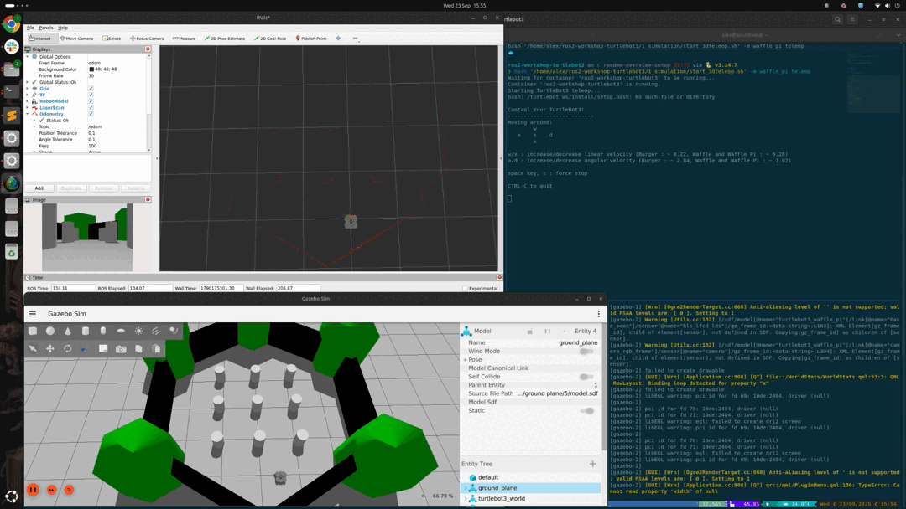
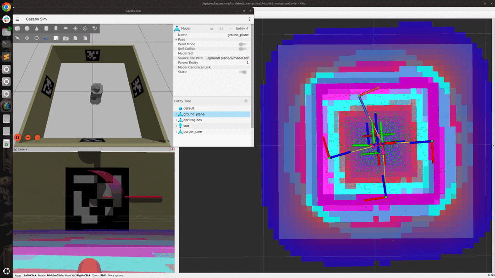
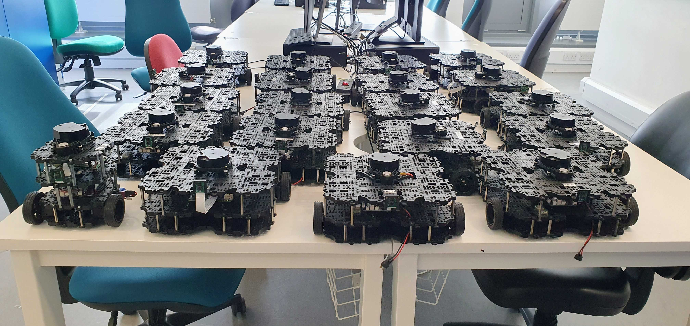

<!-- # ROS 101 Workshop - ROSCon UK 2026 -->


<!-- HEADER -->
<div align="center">

  <h2 align="center">ROS 101 Crash Course - What's this all about?</h2>

  <a>
    
  </a>

  <br />

</div>

<!-- TABLE OF CONTENTS -->
Please visit [Our Wiki](https://github.com/tartanroboticscollective/ros2-workshop-turtlebot3/wiki) for all instructions and materials for this workshop.

<!-- ABOUT THE PROJECT -->
## About

### Workshop Overview

We are excited to welcome you to our hands-on workshop at ROSCon UK 2026, where we will explore:

#### 🐢 ROS fundamentals with Turtlesim
Get comfortable with the core concepts behind ROS nodes, topics, messages, services, commands and more.
#### 🗺️ TurtleBot3 simulation, SLAM & navigation
Move into simulation and learn how a mobile robot can map its environment and navigate autonomously.
#### 🤖 Deploy to a real TurtleBot3 Burger or Waffle
Take what we’ve built in simulation and bring it into the real world.
#### 📷 Camera + AprilTag search
Put everything together by using the TurtleBot3’s camera to search for and detect AprilTags.


We encourage you to actively participate, ask questions, and share your own insights. The workshop is also a space for discussion on how we can collectively improve and standardise simulation and control practices in ROS 2.

---

## Requirements

:computer: Ubuntu or macOS (Apple Silicon) laptop

:pager: [Tmux](https://github.com/tartanroboticscollective/ros2-workshop-turtlebot3/wiki/Tmux-Setup)

:package: [Pixi](https://pixi.prefix.dev/latest/installation/)

The `start_*.sh` scripts install the ROS 2 environment from `pixi.toml` on first run. Run `pixi run build` to build the workshop packages in `src/`.

Please see our [Setup Instructions](https://github.com/tartanroboticscollective/ros2-workshop-turtlebot3/wiki#setup) and more in our Wiki.

## Tutorials

### 0: Introduction + 2D Turtlesim (ROS2 Basics, Tmux, Pixi, Teleoperation)

[Introduction to ROS2](https://github.com/tartanroboticscollective/ros2-workshop-turtlebot3/wiki/Introduction)

### 1: 3D Simulation with Gazebo (Localisation, Mapping, Navigation)

[Simulation Tutorial](https://github.com/tartanroboticscollective/ros2-workshop-turtlebot3/wiki/Simulation)



### 2: Apriltag Simulation with Gazebo (Camera, Apriltag)

[Apriltag Simulation Tutorial](https://github.com/tartanroboticscollective/ros2-workshop-turtlebot3/wiki/Simulation-%26-AprilTags)



### 3: Real Turtlebot (Everything!)

[Real Turtlebot Tutorial](https://github.com/tartanroboticscollective/ros2-workshop-turtlebot3/wiki/Real-Turtlebot)



---
## FAQ

To open a shell in the workshop environment outside of the tmux sessions, run

```bash
$ pixi shell
```

---
<!-- FOOTER -->
<div align="center">
  <a>
    
  </a>

  <br />

  <!-- <h2 align="center">ROS 101 Crash Course - What's this all about?</h2> -->

  <p align="center">
    Tartan Robotics Collective
    <br />
    Centre for AI in Assistive Autonomy, School of Informatics
    <br />
    The University of Edinburgh, United Kingdom
  </p>
</div>
